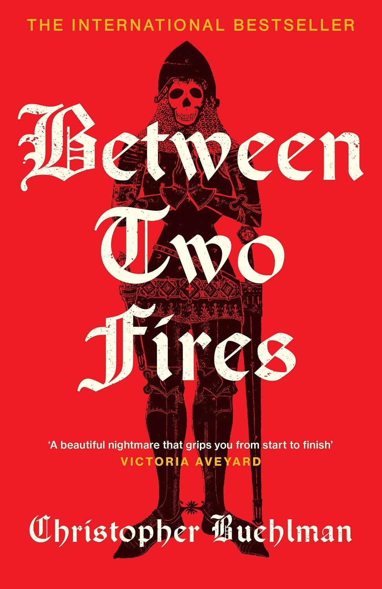

+++
title = 'Between Two Fires by Christopher Buehlman'
date = '2026-11-08T19:04:15-06:00'
draft = false
categories = ['Reviews']
tags = ['Horror', 'Historical Fiction']
coverImage = 'cover.jpg'
+++

*Between Two Fires* by Christopher Buehlman is a medieval historical horror novel, which is not a genre I would normally read. The overall reading experience was also a little strange for me, not because of the story itself, but because of the way I ended up reading it.

I started with the regular book and made it about 45 percent of the way through before I unexpectedly received a free Audible version. I decided to give the audiobook a try, but at first I wasn't sure I was going to stick with it. The narrator's voice for the young girl felt awkward to me, and I had a hard time getting into the performance.

After a chapter or two, I went back to reading. The problem was that I found the book overall to be fairly slow and plodding, so eventually I returned to the Audible version and finished it that way.

The story takes place in plague-ravaged medieval France and follows a disgraced knight and a mysterious young girl as they travel across the country. Without giving too much away, what begins as a journey through a world devastated by the Black Death gradually becomes something much larger; a struggle between good and evil, with the characters caught somewhere in the middle.

Although I found much of the journey slow, the book became considerably more engaging toward the end. I particularly enjoyed the final confrontation and climax, and by that point I was genuinely interested in seeing how everything would be resolved.

Overall, *Between Two Fires* was okay. Medieval horror probably isn't going to become one of my regular genres, but I did enjoy the way the story came together in the end.
